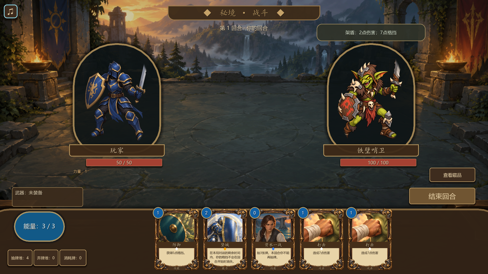

# Mycecard

一款使用 Godot 制作的回合制卡牌冒险游戏。在开局构筑牌组、挑选藏品，沿分支路线挑战敌人，在不期而遇中作出选择，最终迎战 Boss。



当前版本：**v0.6.1**。项目处于开发阶段，已包含从开局构筑到胜败结算的完整单局流程。

## 游戏内容

- 29 张卡牌，包含攻击、技能、能力和武器；开局依次选择传说、史诗、稀有卡牌，组成 9 张初始牌组。
- 4 种普通敌人、3 种 Boss，采用单敌人回合制战斗，支持格挡、力量、虚弱、易伤及武器耐久等机制。
- 五层、11 个节点的分支地图。三条路线各自随机安排两场普通战斗和一次不期而遇，最终通向 Boss。
- 3 件开局藏品和 3 个不期而遇。战斗奖励可以领取或跳过，不期而遇可以恢复生命、获得卡牌或调整牌组。
- 共用卡面、出牌与战斗反馈动画、音效、背景音乐和独立声音设置。

## 运行

使用 **Godot 4.6.1** 打开仓库根目录的 [project.godot](project.godot)，等待资源导入完成后按 **F5** 运行。

游戏通过鼠标操作：点击卡牌出牌，点击武器攻击，点击“结束回合”推进战斗。牌堆和藏品按钮可查看详情，左上角的音乐按钮用于调整声音，**Esc** 关闭最上层窗口。

建议分辨率为 1280×720 或更高，最低窗口尺寸为 1024×600。

## 开发

工程工具使用 **Python 3.12.7**。按[环境配置](docs/current/environment.md)设置 `GODOT_BIN` 后，可以检查环境、运行回归和验证干净副本：

```powershell
python tools/project.py doctor
python tools/project.py test
python tools/project.py clean-check
```

Windows 导出使用匹配版本的 Godot 导出模板：

```powershell
python tools/project.py release
```

导出结果保存在 `release/refactor/<run>/`。测试分组、模板配置和发布参数见[开发与构建](docs/current/development.md)。

## 项目结构

| 目录 | 内容 |
| --- | --- |
| `battle/` | 战斗规则、运行状态、战场显示和表现 |
| `run/` | 单局流程、地图、构筑、奖励和不期而遇 |
| `cards/` | 卡牌定义、牌组条目、卡面与卡牌资源 |
| `characters/` | 可选角色配置：战斗角色引用、起始牌组与奖励池 |
| `combatants/` | 公共战斗角色定义与视图，玩家和敌人的专属内容 |
| `collections/` | 藏品定义、资源与图标 |
| `ui/` | 共用控件、主题、页面导航和浮层 |
| `assets/`、`audio/` | 按用途分类的美术、音乐及音效 |
| `tests/`、`tools/` | 回归检查、构建工具和实验入口 |
| `docs/` | 玩法、架构、内容编辑和开发说明 |
| `卡牌标准模型/`、`敌人标准模型/`、`综合数值模型/` | 数值模型、历史基线和独立实验 |

## 文档

- [玩法与内容](docs/current/gameplay.md)
- [项目架构](docs/architecture/架构与重构记录.md)
- [目录组织与整理记录](docs/architecture/目录组织与整理记录.md)
- [界面修改入口](docs/current/ui-editing.md)
- [新增与调整内容](docs/current/content-authoring.md)
- [数值模型与实验](docs/current/numerical-baselines.md)
- [音乐与音效](audio/README.md)
- [完整文档索引](docs/README.md)
