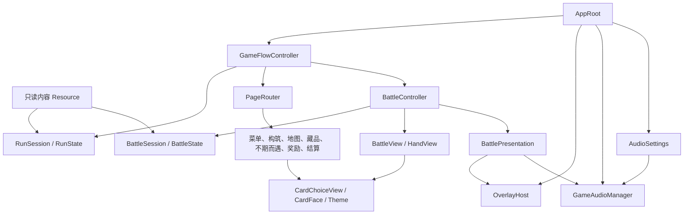

# 项目架构

Mycecard 将内容定义、整局规则、战斗规则、页面编排和表现服务分开。规则模型可独立于场景树运行；游戏页面与数值实验共用战斗实现。

## 分层与依赖

规则模型使用 RefCounted，独立于界面、场景树和音频服务执行。页面负责收集意图和展示；流程层转交命令并按会话阶段选择页面。应用根节点装配驻留的音频、浮层与设置界面，服务通过明确引用传入。

| 模块 | 权威职责 | 主要文件 |
| --- | --- | --- |
| 内容定义 | 卡牌、敌人、地图、藏品、不期而遇的静态配置 | 各领域 `data/*.tres` 与定义脚本 |
| 整局规则 | 当前阶段、候选、路线、牌组、生命、命令提交和结果防重 | [RunSession](../../run/model/run_session.gd)、[RunState](../../run/model/run_state.gd)、[RewardState](../../run/model/reward_state.gd) |
| 战斗规则 | 初始化、合法动作、费用、效果、回合、胜负与结算结果 | [BattleSession](../../battle/model/battle_session.gd)、[BattleState](../../battle/model/battle_state.gd) |
| 流程编排 | 页面意图转交规则；准备、提交页面并切换音乐 | [GameFlowController](../../run/game_flow_controller.gd) |
| 页面生命周期 | 根类型校验、隐藏准备、提交、旧页释放和来源识别 | [PageRouter](../../ui/navigation/page_router.gd) |
| 战斗适配 | 视图输入转交规则、快照与实际事件转交表现 | [BattleController](../../battle/battle_controller.gd) |
| 战斗展示 | 控件刷新、尺寸适配、查看器、按实际卡实例维护手牌 | [BattleView](../../battle/view/battle_view.gd)、[HandView](../../battle/view/hand_view.gd) |
| 视觉与音频 | 动画、结算反馈、跨页提示、播放与混音 | [BattlePresentation](../../battle/presentation/battle_presentation.gd)、[OverlayHost](../../ui/overlay/overlay_host.gd)、[GameAudioManager](../../audio/audio_manager.gd) |
| 应用装配 | 创建设置场景并连接服务；提供共享主题；统一正常退出 | [AppRoot](../../ui/app_root.gd)、[main.tscn](../../main.tscn) |

代码按 `battle/`、`run/`、`cards/`、`combatants/`、`collections/` 等领域组织。跨场景共用的选牌、查看器、导航、浮层和主题位于 `ui/`。

领域根目录或专属子模块保存定义脚本，`data/` 只保存资源实例。玩家与敌人分别位于 `combatants/players/`、`combatants/enemies/`，共享定义与视图位于 `combatants/` 根部。`characters/` 表示可选角色的整体配置，不等同于战斗基础属性。美术集中在 `assets/`，按卡牌、战斗角色、背景与界面分类。完整位置和迁移说明见 [目录组织](./目录组织与整理记录.md)。

## 整局命令与单次提交

`RunSession` 是游戏流程的整局命令入口，明确区分地图选择、战斗、奖励、不期而遇选择与结果、藏品选择、构筑和胜败阶段。

每次接受命令递增 `step_token`。页面连接信号时绑定当前步骤；处理回调时同时核对当前页面来源与步骤。视图通过会话提交生命、牌组、奖励和节点操作。`RunState` 保存基础状态，也供模型与固定条件测试使用。

奖励状态保存所属节点、战斗身份、本轮候选、轮数和提交记录。重建页面只读取候选；进入下一轮才抽样。战斗结果包含 `battle_id`、`node_id`、胜负、实际生命和最大生命；会话校验后统一提交。普通胜利的藏品治疗、奖励进入和节点完成各执行一次。

不期而遇采用 [选项定义](../../run/encounter/unexpected_encounter_option_definition.gd) 与 [局部执行器](../../run/encounter/unexpected_encounter_executor.gd)。定义包含稳定 ID、选择方式、条件、生命费用、效果和结果文案模板；执行器提供选项可用性、候选和纯结果提案，会话提交实际支付与收益。视图不按营地、祭坛或泉的种类重写业务规则。加入复用现有效果的第四个实例只需配置资源。

冒险内容与战斗抽牌分别使用 [RunRNG](../../run/model/run_rng.gd) 的两个随机流。新局记录种子；指定 `GameFlowController.run_seed` 并使用相同配置可重现本局。页面翻页和重建读取已有候选，不消耗内容随机流。

## 页面准备、提交与失败恢复

新页面在最终页面容器中隐藏、禁用处理，并校验具体根脚本及初始化结果。提交时直接恢复显示与处理模式，停止并移除旧页。准备和提交之间不重新挂载新页面，避免触发 `_exit_tree()`，提前销毁已准备的战斗会话。

战斗分为 `prepare_battle()` 与 `activate_battle()`：准备只构建 SETUP 状态；页面成功提交后才启动首回合、抽牌和反馈。错误根类型、缺少控制器、初始化失败时保留旧页。

规则已提交而展示失败时，由 [导航错误场景](../../ui/navigation/navigation_error.tscn) 提供重试／返回。重试根据当前状态重新展示，不再次执行业务命令。例如奖励页面失败后，治疗、候选和步骤都保持原值。过期步骤拒绝旧页再次提交。

## 战斗规则、显示与表现

`BattleSession` 使用同步 ActionQueue 和统一 AttackDamageResolver；费用、武器、能力、多段伤害、自损致死中断及敌人阶段均在规则层处理。合法操作查询供输入入口与按钮显示共同使用。

`BattleController` 将页面操作转交给会话。出牌前制作独立 CardFace 快照；命令拒绝即释放，接受后交给表现层。逐段 [BattleEvent](../../battle/model/battle_event.gd) 携带战斗身份、顺序、来源、目标和实际数值。先转交实际事件，再刷新视图并报告可能切页的 [BattleResult](../../battle/model/battle_result.gd)。规则结算同步完成，动画和声音读取结算结果。

HandView 按 CardInstance 身份保存控件，保留仍在手中的视图，清理已离开的卡及旧武器输入；出牌动画持有独立快照。布局随尺寸、模型和组件变化刷新，战斗页面不逐帧重复读取文字。

## 浮层与声音所有权

OverlayHost 统一悬停、战斗反馈、页面模态、终局提示和设置的层级约定。Esc 每次只关闭最上层模态；模态阻挡地图、战斗与悬停输入。页面退出清理它拥有的查看器，反复开关取消对应退出连接；设置属于应用，可跨页面保留。

声音设置位于独立 `.tscn`，通过音量、静音接口操作音频管理器。管理器负责播放、混音、交叉淡化、去重和音乐压低。战斗反馈随战斗销毁；终局短提示属于应用浮层，可跨页完成。新局清理过渡提示。

AppRoot 接管窗口关闭请求，幂等关闭页面与设置输入、清理临时浮层，并调用音频管理器的 `shutdown()`。管理器跟踪 AudioStreamPlayback 弱引用，停止并解绑播放源后逐帧等待实例释放；默认5秒超时返回失败。清理完成后调用 `SceneTree.quit()`。构建工具的独立启动检查共用这条退出流程。

## 测试、构建与扩展

[工程工具](../../tools/project.py) 管理导入、分组测试、干净源副本、数值实验、Windows 构建和独立启动。测试核对完成标记、退出码、预期错误次数和超时，构建记录来源文件与产物指纹。使用方式见 [开发指南](../current/development.md)。

数值评估直接调用 BattleSession，实验使用独立源码副本与固定条件，说明见 [数值模型](../current/numerical-baselines.md)。

当前游戏为单敌人、本地单局冒险，尚未提供持久存档与联网。扩展卡牌和不期而遇时优先沿用资源配置与局部规则模块；界面修改入口见 [界面编辑](../current/ui-editing.md)。
